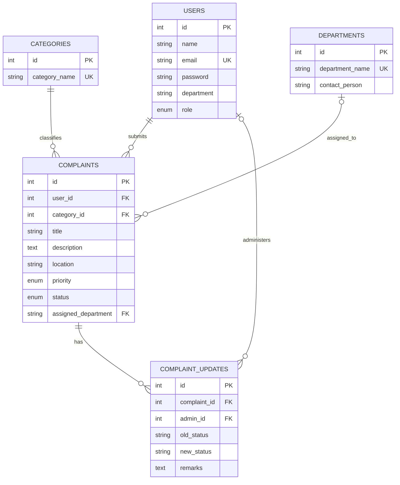

# CampusCare — Campus Complaint Management System

CampusCare is a full-stack college DBMS project for students to report campus issues and administrators to review, route, and resolve them. The application uses a MySQL database for all persistent records; JWTs are used only for authenticated sessions.

## Stack and architecture

- React 18, Vite, Tailwind CSS, React Router, Axios, Lucide React, Recharts
- Node.js, Express, mysql2, MySQL 8+, bcryptjs, JWT
- `frontend/` provides role-specific dashboards and forms. `backend/` validates requests, enforces student/admin access, and runs parameterized SQL against `campuscare`.

## Database and relationships

`users` owns complaints; each complaint references one category and optionally an assigned department. `complaint_updates` links administrative history to a complaint and (optionally, after account deletion) an administrator. The `complaint_summary` view joins student and category labels. Foreign keys, unique emails/categories/departments, required fields, indexes, and explicit delete rules are defined in `database/schema.sql`.



## Setup

Requirements: Node.js 20+, npm, and MySQL 8+. Run these commands from the project directory in PowerShell:

1. Create the backend environment file. The helper prompts for the MySQL password without echoing it and generates a random JWT secret:

   ```powershell
   .\backend\configure-env.ps1
   ```

   It writes only to the ignored local file `backend/.env`; it never prints the password. To configure manually instead, copy `.env.example` to `backend/.env` and edit it locally. Keep `DB_NAME=campuscare` and `CLIENT_URL=http://localhost:5173`. The configured MySQL account must have privileges for the database.

2. In PowerShell, initialize schema, lookup data, and procedure in this order. `cmd /c` is used for MySQL's SQL-file input redirection:

   ```powershell
   cmd /c "mysql -u root -p < database\schema.sql"
   cmd /c "mysql -u root -p campuscare < database\seed.sql"
   cmd /c "mysql -u root -p campuscare < database\procedures.sql"
   ```

   Replace `root` with the MySQL account you configured. If MySQL is not on `PATH`, run these commands from its `bin` directory or use the full path to `mysql.exe`.

3. Install dependencies and load demo accounts/complaints:

   ```powershell
   npm install
   npm install --prefix backend
   npm install --prefix frontend
   npm run seed --prefix backend
   npm run verify-db --prefix backend
   npm run test:smoke --prefix backend
   ```

   The seed command adds one admin and ten student demo accounts if their emails are absent, inserts default categories/departments when missing, and adds any missing sample complaints and history. It can be rerun without duplicating sample complaint rows and preserves existing accounts/passwords. On a fresh database, demo accounts use the documented hashed password `CampusCare2026!`. Do not use the demo seed against a production database. `verify-db` prints row counts, checks foreign-key orphans, queries the summary view, and calls the stored procedure without printing student details.

4. Start both services with `npm run dev`; frontend is at `http://localhost:5173`, API at `http://localhost:5000`. For a production client build use `npm run build`; run the API with `npm start`.

Demo logins:

- Admin: `admin@campuscare.edu` / `CampusCare2026!`
- Student: `aarav.mehta@campus.edu` / `CampusCare2026!` (nine other sample accounts are listed in `backend/seed.js`.)

## Features

- Student account registration, login, private dashboard, complaint submission/history/details, status timeline, and profile update.
- Admin overview with live MySQL aggregates and category/status/department charts; complaint filtering, status/remarks management, department assignment, student directory/history, department management, monthly reports.
- Authenticated role checks on APIs; complaint ownership is enforced in the detail query. Passwords are bcrypt hashed and excluded from API responses. Status plus history writes use a SQL transaction.
- Responsive layout, search/filter, empty states, loading placeholders, status/priority indicators, and success notifications.

## API

All paths are prefixed by `/api`. Authenticated routes accept `Authorization: Bearer <token>`.

| Method | Endpoint | Access | Purpose |
|---|---|---|---|
| POST | `/auth/register` | Public | Register student |
| POST | `/auth/login` | Public | Login; returns token and safe user record |
| GET | `/auth/me` | Authenticated | Current user |
| GET | `/categories`, `/departments` | Public | Form options |
| GET | `/student/dashboard` | Student | Own aggregate stats and recent complaints |
| POST | `/complaints` | Student | Create complaint |
| GET | `/complaints/my` | Student | Search/filter/sort own complaints |
| GET | `/complaints/:id` | Owner or admin | Details and update timeline |
| PATCH | `/student/profile` | Student | Update own profile |
| GET | `/admin/dashboard` | Admin | Aggregate dashboard and chart series |
| GET | `/admin/complaints` | Admin | Search and filter complaints |
| PATCH | `/admin/complaints/:id/status` | Admin | Transactional status/remark update |
| PATCH | `/admin/complaints/:id/assign` | Admin | Assign department |
| GET | `/admin/students`, `/admin/students/:id` | Admin | Student directory and complaint history |
| GET | `/admin/reports` | Admin | Monthly report aggregates |
| GET/POST | `/admin/departments` | Admin | Department directory and create |
| GET | `/health` | Public | API/MySQL readiness check |

## DBMS concepts demonstrated

Database/table creation, primary and foreign keys, unique/NOT NULL/ENUM constraints, inserts, updates, deletes, selects, WHERE, ORDER BY, GROUP BY, COUNT/SUM, INNER/LEFT JOIN, subqueries, indexes, transaction, view, and stored procedure are represented in `database/schema.sql`, `database/queries.sql`, and `database/procedures.sql`. Run `CALL get_complaint_statistics();` to see the stored procedure output.

## Verification and screenshots

Verification on the configured local MySQL instance: 11 users, 8 categories, 6 departments, 20 complaints, and 11 complaint updates. `complaint_summary` returned 20 rows; the stored procedure returned total 20 (9 pending, 5 in progress, 6 resolved, 0 rejected), with 8 category rows. The three checked FK orphan counts were all zero.

`npm run test:smoke --prefix backend` passed 18 live API/MySQL checks covering admin and student login, student registration, complaint submission/list/detail, cross-student and role denial, admin listing, department assignment, transactional status/history update, student/admin dashboard aggregates, persistence, and frontend-origin CORS. It deletes only its unique temporary QA student afterward; counts returned to the seeded baseline.

`npm run build` and Node syntax checks for `server.js`, `seed.js`, `verify-db.js`, and `smoke-test.js` passed. Offline dependency audits for backend and frontend reported zero vulnerabilities. The API health route returned HTTP 200 with `database: connected`; the frontend served HTTP 200 at `http://localhost:5173/`; both development servers were started. In the in-app browser, admin login displayed the live dashboard and database rows. The revised sign-out navigation handler was added after a browser click did not navigate; that exact revised browser interaction was not re-run. The student/admin workflows otherwise passed through live API tests.

Screenshots: add dashboard and complaint detail captures here after launching the application.
